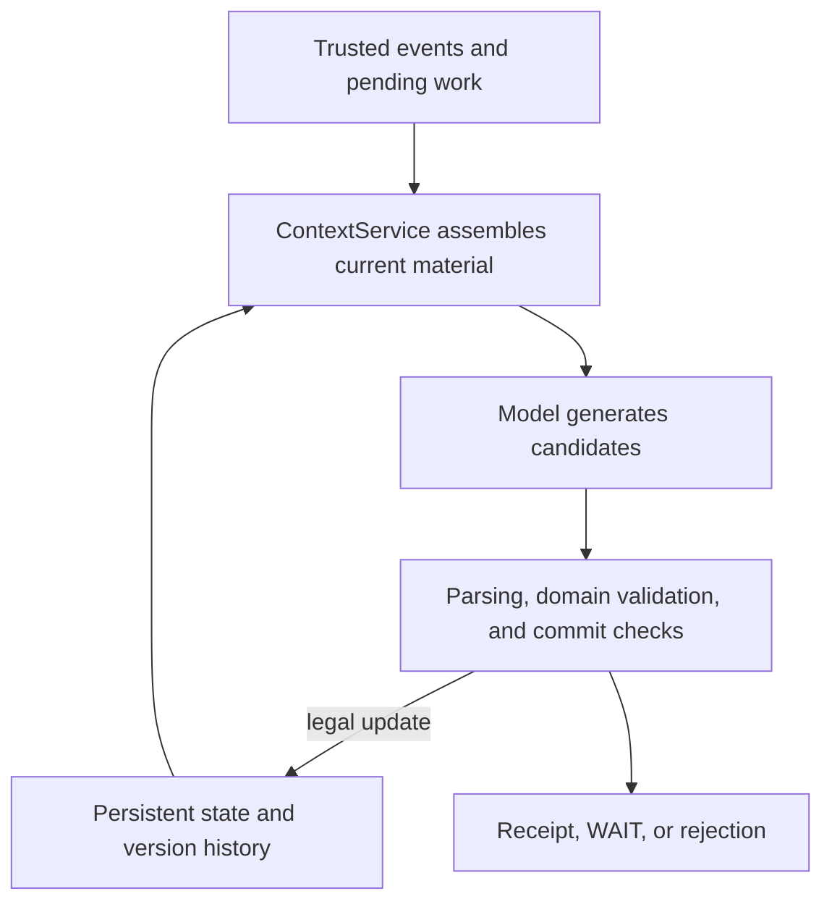
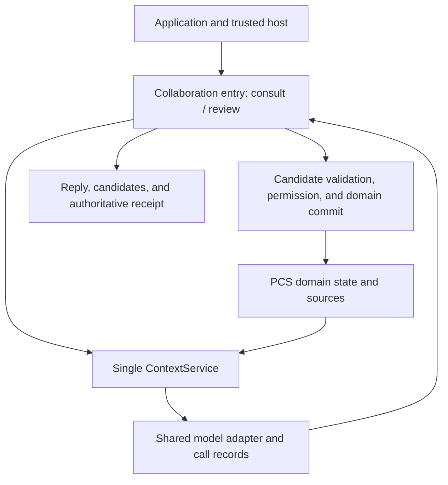

# QUINTESSENCE Architecture

**How persistent state carries experience, and how the model participates in belief revision.**

**English** · [简体中文](ARCHITECTURE.zh-CN.md)

> Status checked 2026-10-21. This document separates implemented mechanisms from approved target design. The unified LLM–PCS collaboration layer is not implemented. Design approved; implementation pending. Target relationships in the diagrams do not describe the current deployment.
>
> Status terms: **Implemented** = present in the current code and covered by tests; **Approved design** = design accepted, not implemented; **Planned** = scheduled after P0; **Research direction** = long-term inquiry, not an engineering commitment.

[Project overview](README.md) · [Roadmap](ROADMAP.md)

## 1. Starting point: state across model calls

PCS (Persistent Cognitive System) is QUINTESSENCE's overall architectural identity. A model call can end, while the system's experiences, current beliefs, version history, and unfinished work continue to exist.

The model participates in inference based on explicitly supplied context and emits candidates or answers. Updates to persistent beliefs are determined by PCS domain rules and commit mechanisms. This makes it possible to study how system state accumulates and changes while model parameters remain fixed; whether state actually updates and whether behavior actually changes still require separate verification.

| Object | Ownership and responsibility |
|---|---|
| PCS | Authoritative cognitive state, provenance, versions, domain validation, and formal Context |
| LLM | Inference and candidate generation; cannot self-certify tool success, source trust, or authorization |
| Host (e.g., DSH; not yet integrated) | Session, runtime environment, real tool execution, and host-side authorization |
| Application | User input, result presentation, and interaction; consumes the unified interface |
| Private instance | Individual configuration and persistent experience; not bundled with general source code or model weights as one asset |

Model replaceability is an architectural principle; current work does not promise behavioral equivalence or lossless migration between arbitrary models.

## 2. Existing foundation

The current core has persistent storage, version updates, Context assembly, model ports, and Belief domain operations. The names below describe components in the current technical report; they are not stable API commitments for the public package.

| Component | Current responsibility |
|---|---|
| State Store / commit transactions | Stores state and history; performs controlled appends, version checks, and commit receipts |
| Domain services / BeliefService | Validates belief operations, evidence, and scope; applies legal changes |
| ContextService | Loads and assembles formal context; binds material, versions, and a state snapshot |
| ModelPort / DirectHttpModel | Model-call abstraction and the existing real HTTP call path |
| Proposal parsing and validation | Parses model output; rejects unsupported fields and illegal operations |
| CognitionRuntime.run_step | Orchestrates the existing bounded cognitive step, validation feedback, and limited retries |

### Experience, evidence, and belief

These concepts cannot be treated as interchangeable merely because their text looks similar:

| Concept | Meaning and boundary |
|---|---|
| Event | A record of an input or observation that occurred; trust depends on its source and cannot be granted by a model's self-report |
| Evidence | A source used by a judgment that satisfies the relevant rules; citing the same source again does not create independent evidence |
| Episode | An organizational form of experience; currently only a minimal foundation, not full memory organization or semantic retrieval |
| Belief | A belief with provenance, applicability scope, status, and version; it can be retracted or superseded |
| Knowledge | The planned projection and retrieval of valid knowledge; not an existing independent fact store |

User statements, model inferences, and actual tool observations retain different source semantics. Storing a sentence does not automatically make it a fact or a Belief.

### Current core cognitive step

The diagram describes the responsibility relationships of the existing core step. The formal v4 experiment and the legacy Workbench have their own orchestration, described in the next section.

A typical revision path includes retracting an earlier judgment, reading the updated state and building a new Context, and proposing a replacement belief. The two operations are not a single whole that can be skipped by a verbal promise; if the second step fails or WAITs, the system must not report that the replacement belief has been established.

Existing validation and bounded feedback constrain model operations, but they cannot guarantee that the model triggers the correct operation every time, nor prove open-world conclusions true.

## 3. Three existing call paths

| Path | Actual situation | Boundary |
|---|---|---|
| PCS Core | Local closed loop of Context, model call, candidate parsing, and domain commit | Bounded cognitive operation; not a complete open-ended conversation protocol |
| EXP-01 v4 | Q1/Q2 use formal Context and some core mechanisms, orchestrated by the experiment adapter; Advice uses a separate call branch | Controlled research implementation; not every step goes through run_step or the unified collaboration layer |
| Workbench V0.2 | The prototype assembles some prompts, retrieval, and HTTP itself and reuses some PCS capabilities | Standalone demo; not unified into the core interface |

The legacy Workbench is frozen and will not be reused or migrated into the new application. Its operating experience clarified the need for a unified collaboration layer, but it is not evidence that the layer has been delivered.

Specific request formats required by the old experiments remain within the original protocol scope. A future collaboration layer may use explicit, versioned multi-message formats without silently changing historical experiment contracts.

## 4. Approved design: unified LLM–PCS collaboration layer

**Status: approved design, not implemented.** The proposal uses a thin coordination entry point (Facade) inside the PCS library and extracts existing generation and commit steps for application reuse. It does not create a second authoritative cognitive state and does not add a resident cognitive server.

The target relationships are:

### Two interactions, separate update responsibilities

| Mode | Purpose | State impact |
|---|---|---|
| consult | Consultation, query, and answer over currently accessible material | May store audit records; does not create cognitive work, write Belief, or refresh persistent SelfView |
| review | Review beliefs against events and pending work; propose candidates | After generation, commit according to permissions and domain rules; may also wait, reject, or fail |

consult does not automatically become review just because the model says “this should be remembered.” In review, candidate generation, structural validity, candidate approval, and successful commit are distinct stages. Natural-language UI text cannot override actual system results.

### Generation and commit are separate

A candidate is bound to its original Context, work, content, and a stable request identifier. Confirmation re-checks whether the candidate is still valid; an old candidate cannot be silently rebound to a new state.

Rejection is terminal for that candidate and blocks automatic reruns of the corresponding work. Restart, a new session, or a new request identifier cannot lift the rejection; reconsideration requires explicit authorization and produces a new candidate. If a commit has already succeeded, a later rejection cannot pretend to undo it; retracting the belief requires a separate domain operation.

Commit facts are determined by the authoritative receipt. The goal is to recover results when a commit succeeds but the response is lost, avoiding duplicate appends; this is a bounded engineering mechanism, not an exactly-once guarantee across arbitrary external systems.

### Queries must return to formal Context

The collaboration layer's deterministic query path reads permitted beliefs, versions, and applicability information. Query results are assembled through the same ContextService before being given to the model; applications must not assemble their own hidden cognitive material.

First-phase interactions have explicit call limits, and queries and repair share a budget; they do not recursively expand into an arbitrary Agent Loop. No result, WAIT, rejection, invalidation, and call failure are each reported separately, with no hidden background retry.

## 5. Collaboration experience and future memory

The approved design stores inputs, answers, candidates, and processing results as traceable interaction-experience sources and provides an exact-reference read interface. These records can become material for future Memory/Episode work, but they do not automatically become long-term memory or current belief.

Three kinds of content remain distinct: interactions that occurred, beliefs committed through domain rules, and Episodes or knowledge projections that may later be formed through selection and organization.

The first phase implements only the experience-read bridge and synthetic consumer validation; it does not implement automatic summarization, semantic retrieval, or Episode writing. A rejected candidate can also be described as “proposed but not accepted”; it must not be repackaged as a fact. Model output always retains model-source semantics.

Future organization of experience must inherit exact provenance, versions, and deletion dependencies. Copying content must not bypass deletion of the original source, nor create new independent evidence.

## 6. Authorization, deletion, and persistence boundaries

Existing core checks for evidence, versions, watermarks, and deletion remain in place; the collaboration layer will extend source registration, deletion propagation, and permission enforcement points for inputs and outputs. The new mechanisms are still part of the approved, unimplemented design.

The first-phase trust model is a **single-user trusted host**. The host establishes call identity and valid authorization; namespace is used for logical isolation, scope expresses applicability, and authorization references support audit. None of these is authentication by itself.

- Reading an instance, sending private content outward, automatic commit, memory integration, and rerun after rejection are authorized separately.
- Permission to send content to a model does not imply permission to modify beliefs; permission to commit does not imply permission to send private content outward.
- Current permission is checked before every model send and retry; the model cannot create authorization in its output.
- Deletion first establishes an unreadable barrier, then cleans registered derived content; old Contexts and dependent material should become invalid.
- Raw request records support review but are constrained by privacy and retention policies; after deletion, full text is not guaranteed to be recoverable.

This design does not defend against malicious same-process code operating on the underlying storage directly, and it is not a multi-tenant network-service security design.

## 7. Long-term position of the five capabilities

| Capability | Research responsibility | Current implementation scope |
|---|---|---|
| Persona | Continuity of identity and dispositions; contextual feedback | Minimal Profile foundation; P1 contextual feedback pending |
| Memory | Retention, organization, selection, and reuse of experience | Minimal event and Episode foundation; full integration and retrieval pending |
| Cognition | Form and revise beliefs; carry questions and focus forward | Belief / Context and the controlled operation chain are implemented; Question / Focus pending |
| Affect | Source-bearing evaluation of objects and experiences | Research direction |
| Load & Recovery | Activity load, stopping, and recovery rhythm | Long-term mechanism pending; current call budgets are not a complete load system |

The five are conceptual responsibility divisions; whether they become separate modules depends on implementation needs. Shared state and provenance do not imply that every domain uses the same update rules.

Long-term triggers for cognitive activity may include accumulated experience, state changes, unresolved problems, and persistent focus. The first collaboration layer provides only manual, bounded entry points and does not claim autonomous continuous operation.

## 8. How to validate the architecture

Engineering acceptance checks channels and constraints: candidates are not committed early, repeated confirmation does not duplicate updates, rejection does not trigger automatic rerun, restart is recoverable, and deletion and permission changes can block reuse of old material.

Real-model research separately checks content and behavior: whether the right material is selected, whether the actual request contains the correct version, whether the output uses the applicable scope correctly, and whether judgments in new situations are reasonably affected. Citing a record or claiming to “remember” is not a substitute for behavioral evidence.

The collaboration-layer plan uses a sequence of post-revision restart and chat-cache clearing to separate the effect of persistent state from that of chat context, with controls for no revision, no relevant history, and a temporary equivalent summary. Performance similar to an equivalent summary does not negate the value of maintaining and revising long-term state.

These are acceptance designs for the next stage and cannot be counted toward PCS2-010 results in advance. Current experiment boundaries and next steps are in [ROADMAP.md](ROADMAP.md).
