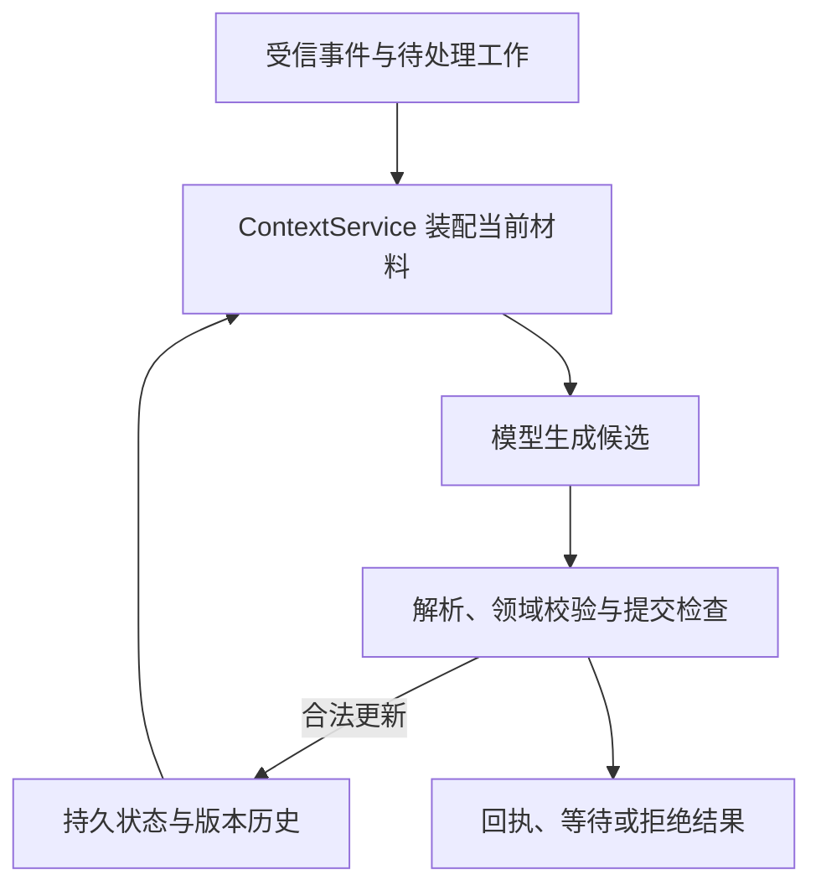
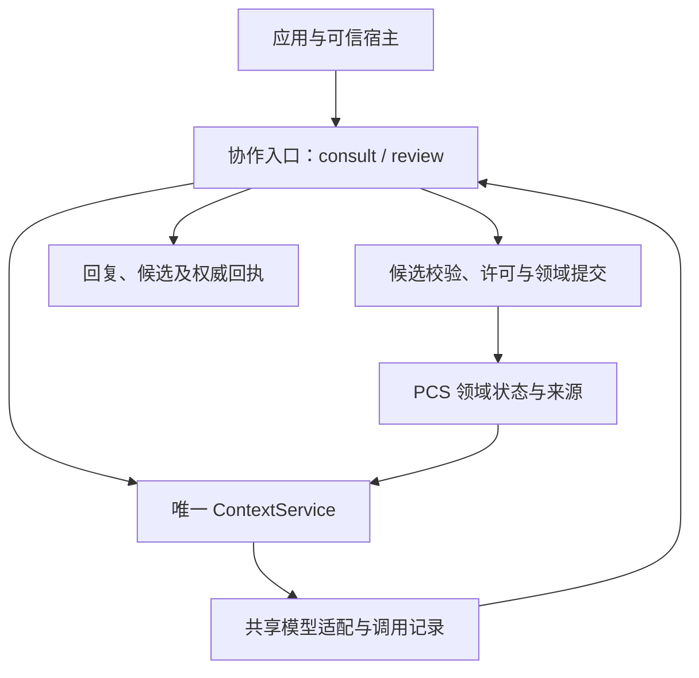

# QUINTESSENCE Architecture

**持久状态如何承接经历，模型如何参与认识更新。**

[English](ARCHITECTURE.md) · **简体中文**

> 状态核对：2026-10-24。本文区分已有实现与未来设计。P0 统一 LLM–PCS 协作层已在当前审查分支实现，并有受控真实模型证据；尚未合并 `main`，正式发行打包与人工研究评价仍是独立步骤。
>
> 状态用语：**已实现** = 当前代码中存在并有测试覆盖；**已批准设计** = 设计已批准、尚未实施；**规划中** = P0 之后安排；**研究方向** = 长期研究，不构成工程承诺。

[项目介绍](README.zh-CN.md) · [演进路线](ROADMAP.zh-CN.md)

## 1. 架构起点：状态跨越模型调用

PCS（Persistent Cognitive System，持久认知系统）是 QUINTESSENCE 的整体架构定位。一次模型调用可以结束，而系统中的经历、当前认识、版本历史和未完成工作继续存在。

模型基于显式提供的上下文参与推理，输出候选或回答。持久认识的更新由 PCS 的领域规则和提交机制决定。因此，可以在固定模型参数的情况下研究系统状态如何积累与变化；状态确实更新和行为确实改变仍需分别验证。

| 对象 | 所有权与责任 |
|---|---|
| PCS | 权威认知状态、来源、版本、领域校验与正式 Context |
| LLM | 推理与候选生成；不能自行认定工具成功、来源可信或获得授权 |
| 宿主（如 DSH；尚未集成） | 会话、运行环境、真实工具执行及宿主侧授权 |
| 应用 | 用户输入、结果展示与交互；目标是消费统一接口 |
| 私有实例 | 个体配置及持续经历；不与通用源码、模型权重绑定为同一资产 |

模型可替换是一项架构原则，当前不承诺任意模型之间行为一致或无损迁移。

## 2. 已有底座

现有核心已有持久存储、版本更新、Context 装配、模型端口以及 Belief 领域操作。以下名称描述当前技术报告中的组件，不代表公开包的稳定 API 承诺。

| 组件 | 当前职责 |
|---|---|
| State Store / 提交事务 | 保存状态和历史，执行受控追加、版本检查与提交回执 |
| 领域服务 / BeliefService | 校验认识操作、证据与范围，应用合法变更 |
| ContextService | 读取与装配正式上下文，绑定材料、版本及状态快照 |
| ModelPort / DirectHttpModel | 模型调用抽象与已有真实 HTTP 调用路径 |
| 提议解析与校验 | 解析模型输出，拒绝不支持的字段和不合法操作 |
| CognitionRuntime.run_step | 编排已有的有界认知步骤、校验反馈与受限重试 |

### 经历、证据与认识

这些概念不能仅凭文本相似就互换：

| 概念 | 含义与边界 |
|---|---|
| Event | 发生过的输入或观察记录；可信程度取决于来源，不能由模型自报成功赋予 |
| Evidence | 被某个判断使用、满足相应规则的来源；重复引用同一来源不增加独立证据 |
| Episode | 对经历的组织形式；当前仅有最小基础，不代表完整记忆整理与语义检索 |
| Belief | 带来源、适用范围、状态和版本的认识，可撤回或被替代 |
| Knowledge | 后续规划的有效知识投影与检索能力；不是已经建成的独立事实库 |

用户陈述、模型推断与实际工具观察保留不同来源语义。保存一段话，并不使其自动成为事实或 Belief。

### 当前核心认知步骤

下图描述核心已有步骤的责任关系。正式 v4 实验与旧 Workbench 的具体编排另见下一节。

典型纠正路径包括：撤回旧判断、读取更新后的状态并生成新 Context、提出替代认识。两次操作不是一个可以凭语言承诺跳过的整体；第二步失败或 WAIT 时，不能报告替代认识已经建立。

已有校验和受限反馈能够约束模型操作，但不能保证模型每次触发正确操作，也不能证明开放世界结论为真。

## 3. 当前调用路径

| 路径 | 实际情况 | 使用边界 |
|---|---|---|
| PCS Core | 已有 Context、模型调用、候选解析与领域提交的局部闭环 | 有界认知操作，不是完整开放式会话协议 |
| EXP-01 v4 | Q1/Q2 使用正式 Context 与部分核心机制，由实验适配器编排；Advice 使用独立调用分支 | 受控研究，不等于全部经过 run_step 或统一协作层 |
| P0 桌面协作 | Windows Consult/Review 客户端、可信 sidecar 与正式 consult/review Facade | 审查分支已实现；受控 C13b 真实模型证据；未签名开发版，不是正式发行版 |
| Workbench V0.2 | 原型自行组织部分 Prompt、检索与 HTTP，复用部分 PCS 能力 | 独立展示 Demo，未统一为核心接口 |

旧 Workbench 已决定冻结，不复用或迁移为新应用。其运行经历帮助明确了统一协作层的需求；P0 实现独立于该 Demo。

旧实验要求的特定请求格式保留在原协议范围内。P0 协作层采用显式、版本化的多消息格式，不会偷偷改变历史实验契约。

## 4. 已实现的 P0：统一 LLM–PCS 协作层

**状态：当前审查分支已实现；合并与发行是独立决定。** 实现采用 PCS 库内的薄协调入口（Facade），抽取已有生成与提交步骤供应用复用。它不建立第二套权威认知状态，也不新增常驻认知服务器。

目标关系如下：

### 两种交互，分开的更新责任

| 模式 | 用途 | 状态影响 |
|---|---|---|
| consult | 围绕当前可访问材料进行咨询、查询与回答 | 可保存审计记录，不创建认知 work、不写 Belief、不刷新持久 SelfView |
| review | 根据事件和待处理工作复查认识、提出候选 | 生成后按许可和领域规则提交，也可等待、拒绝或失败 |

consult 不因模型输出“应该记住”就自动转成 review。review 中，生成候选、结构合法、批准候选、提交成功是不同阶段。界面上的自然语言不能覆盖系统实际结果。

### 生成与提交分离

候选绑定其原始 Context、工作、内容与稳定请求标识。确认时重新检查是否仍有效；不能把旧候选静默换绑到新的状态上。

拒绝是该候选的终态，并阻断对应工作的自动重跑。重启、换会话或换请求标识不能解除拒绝；重新考虑需要明确授权，并产生新候选。若提交已经成功，之后的拒绝也不能伪称撤销，撤回认识需要另一个领域操作。

提交事实以权威回执为准。目标是在提交成功但响应丢失等情况下恢复结果，避免重复追加；这是一项有边界的工程机制，不作跨任意外部系统的 exactly-once 保证。

### 查询必须回到正式 Context

协作层的确定性查询负责读取获准的认识、版本与适用性信息。查询结果经同一 ContextService 装配后再交给模型；应用不得自行拼接一套隐含认知材料。

首期交互有明确调用上限，查询与修复共享预算，不递归扩张为任意 Agent Loop。无结果、等待、拒绝、失效和调用失败分别表示，不暗含后台重试。

## 5. 协作经历与未来记忆

P0 实现把输入、回答、候选及处理结果保存为可追溯的交互经历来源，并提供精确引用读取接口。这些记录可以成为未来 Memory/Episode 的材料，但不自动成为长期记忆或当前认识。

三种内容保持区分：发生过的交互、经领域规则提交的认识、未来经过选择和组织形成的 Episode 或知识投影。

首期只实现经验读取桥接及合成消费者验证，不实现自动摘要、语义检索或 Episode 写入。被拒绝的候选也可以解释为“曾提出但未接受”，不能重新包装为事实。模型输出始终保留模型来源语义。

未来组织经历时，需要继承精确来源、版本和删除依赖。复制一份内容不能绕过原来源删除，也不能制造新的独立证据。

## 6. 授权、删除与持久边界

已有核心的证据、版本、水位和删除检查继续保留；P0 扩展输入与产物的来源登记、删除传播和许可执行点。这些机制已在审查分支实现；合并与发行状态是独立问题。

首期信任模型是**单用户可信宿主**。宿主负责建立调用身份与有效授权；namespace 用于逻辑隔离，scope 表示适用范围，授权引用用于审计，它们自身都不是身份认证。

- 读取实例、私人内容外发、自动提交、记忆整合和拒绝后重跑分别授权。
- 获准发送给模型不意味着获准修改认识；获准提交也不意味着获准外发私人内容。
- 每次模型发送及重试前检查当前许可；模型不能在输出中创建授权。
- 删除先建立不可读屏障，再清理登记的派生内容；旧 Context 及依赖材料应失效。
- 原始请求记录有助于复核，但受隐私与保留策略约束；删除后不承诺恢复完整正文。

此设计不防御恶意同进程代码直接操作底层存储，也不是多租户网络服务安全方案。

## 7. 五项能力的长期位置

| 能力 | 研究职责 | 当前落地范围 |
|---|---|---|
| Persona | 身份与倾向的连续性、情境反馈 | Profile 等最小基础；P1 情境反馈待做 |
| Memory | 经历保留、组织、选择与再利用 | 事件和 Episode 最小基础；完整整合与检索待做 |
| Cognition | 形成和修正认识，延续问题与关注 | Belief / Context 及受控操作链已有实现；Question / Focus 待做 |
| Affect | 对对象和经历进行带来源的评价 | 研究方向 |
| Load & Recovery | 活动负荷、停止与恢复节律 | 长期机制待研究；现有调用预算不等于完整负荷系统 |

五项是概念与职责划分，具体模块是否独立由实现需求决定。共享状态和来源，不意味着各领域采用同一套更新规则。

认知活动的长期触发来源可以包括累积经历、状态变化、未解决问题和持续关注。首期协作层仅提供手动、有界入口，不宣称已有自主持续运行。

## 8. 怎样验证这套架构

工程验收检查通道与约束：候选不提前提交、重复确认不重复更新、拒绝后不自动重跑、重启可恢复、删除和权限变化能阻断旧材料使用。

真实模型研究另行检查内容与行为：材料是否选到、实际请求是否包含正确版本、输出是否正确使用适用范围，以及新情境中的判断是否合理受影响。引用一个记录或自称“记得”不能替代行为证据。

P0 验收使用纠正后重启、清空聊天缓存的序列，区分持久状态作用与聊天上下文作用，并保留未纠正、无相关历史及临时等价摘要等对照。与等价摘要表现相近，并不否定系统维护和纠正长期状态的价值。

这些是 P0 的验收条件，不能提前计入 PCS2-010 成绩或人工研究评价。当前实验边界与下一步见 [ROADMAP.zh-CN.md](ROADMAP.zh-CN.md)。
