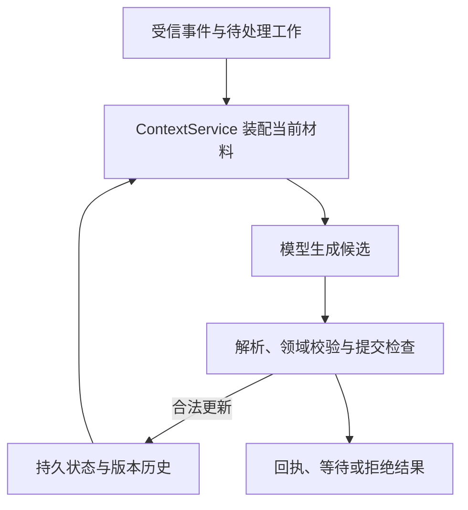
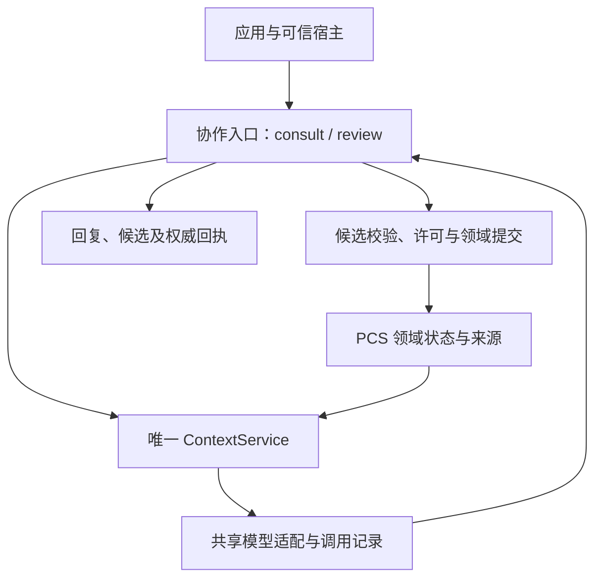

# QUINTESSENCE Architecture

**持久状态如何承接经历，模型如何参与认识更新。**

[English](ARCHITECTURE.md) · **简体中文**

> 状态核对：2026-11-05。本地 main 已包含 J 系列与实例 A/B/C；本文区分实际实现、有限实测和未来设计。本机 Windows 安装已演练，真正干净机与正式签名发行尚未完成。
>
> 状态用语：**已实现** = 当前代码中存在并有测试覆盖；**已批准设计** = 设计已批准、尚未实施；**规划中** = 尚未交付的后续安排；**研究方向** = 长期研究，不构成工程承诺。

[项目介绍](README.zh-CN.md) · [演进路线](ROADMAP.zh-CN.md)

## 1. 架构起点：状态跨越模型调用

PCS（Persistent Cognitive System，持久认知系统）是 QUINTESSENCE 的整体架构定位。一次模型调用可以结束，而系统中的经历、当前认识、版本历史和未完成工作继续存在。

模型基于显式提供的上下文参与推理，输出候选或回答。持久认识的更新由 PCS 的领域规则和提交机制决定。因此，可以在固定模型参数的情况下研究系统状态如何积累与变化；状态确实更新和行为确实改变仍需分别验证。

| 对象 | 所有权与责任 |
|---|---|
| PCS | 权威认知状态、来源、版本、领域校验与正式 Context |
| LLM | 推理与候选生成；不能自行认定工具成功、来源可信或获得授权 |
| 宿主（如 DSH；尚未集成） | 会话、运行环境、真实工具执行及宿主侧授权 |
| 应用 | 用户输入、结果展示与交互；目标是消费统一接口 |
| 私有实例 | 个体配置及持续经历；不与通用源码、模型权重绑定为同一资产 |

模型可替换是一项架构原则，当前不承诺任意模型之间行为一致或无损迁移。

## 2. 已有底座

现有核心已有持久存储、版本更新、Context 装配、模型端口以及 Belief 领域操作。以下名称描述当前技术报告中的组件，不代表公开包的稳定 API 承诺。

| 组件 | 当前职责 |
|---|---|
| State Store / 提交事务 | 保存状态和历史，执行受控追加、版本检查与提交回执 |
| 领域服务 / BeliefService | 校验认识操作、证据与范围，应用合法变更 |
| ContextService | 读取与装配正式上下文，绑定材料、版本及状态快照 |
| ModelPort / DirectHttpModel | 模型调用抽象与已有真实 HTTP 调用路径 |
| 提议解析与校验 | 解析模型输出，拒绝不支持的字段和不合法操作 |
| CognitionRuntime.run_step | 编排已有的有界认知步骤、校验反馈与受限重试 |

### 经历、证据与认识

这些概念不能仅凭文本相似就互换：

| 概念 | 含义与边界 |
|---|---|
| Event | 发生过的输入或观察记录；可信程度取决于来源，不能由模型自报成功赋予 |
| Evidence | 被某个判断使用、满足相应规则的来源；重复引用同一来源不增加独立证据 |
| Episode | 对经历的组织形式；当前仅有最小基础，不代表完整记忆整理与语义检索 |
| Belief | 带来源、适用范围、状态和版本的认识，可撤回或被替代 |
| Knowledge | 已有确定性认识查询与工作集基础；更完整 Knowledge 投影仍待研究，不是独立事实库 |

用户陈述、模型推断与实际工具观察保留不同来源语义。保存一段话，并不使其自动成为事实或 Belief。

### 当前核心认知步骤

下图描述核心已有步骤的责任关系。正式 v4 实验与旧 Workbench 的具体编排另见下一节。

典型纠正路径包括：撤回旧判断、读取更新后的状态并生成新 Context、提出替代认识。两次操作不是一个可以凭语言承诺跳过的整体；第二步失败或 WAIT 时，不能报告替代认识已经建立。

已有校验和受限反馈能够约束模型操作，但不能保证模型每次触发正确操作，也不能证明开放世界结论为真。

## 3. 当前调用路径

| 路径 | 实际情况 | 使用边界 |
|---|---|---|
| PCS Core | 已有 Context、模型调用、候选解析与领域提交的局部闭环 | 有界认知操作，不是完整开放式会话协议 |
| EXP-01 v4 | Q1/Q2 使用正式 Context 与部分核心机制，由实验适配器编排；Advice 使用独立调用分支 | 受控研究，不等于全部经过 run_step 或统一协作层 |
| 当前桌面聊天 | ConversationOrchestrator / collab.v2：内容、工具、SDRPE 和受治理的认识提案，共用正式 Context 与调用账本 | 已实现；表达阶段无工具权限，聊天中的认识变更仍经 Cognition 规则与回执 |
| P0 桌面协作 | Windows Consult/Review 客户端、可信 sidecar 与正式 consult/review Facade | 已实现并合并至 `main`；受控 C13b 真实模型证据；未签名开发版，不是正式发行版 |
| Workbench V0.2 | 原型自行组织部分 Prompt、检索与 HTTP，复用部分 PCS 能力 | 独立展示 Demo，未统一为核心接口 |

旧 Workbench 已决定冻结，不复用或迁移为新应用。其运行经历帮助明确了统一协作层的需求；P0 实现独立于该 Demo。

旧实验要求的特定请求格式保留在原协议范围内。P0 协作层采用显式、版本化的多消息格式，不会偷偷改变历史实验契约。

## 4. 已实现的 P0：统一 LLM–PCS 协作层

**状态：已实现并合并至 `main`；发行与签名是独立决定。** 实现采用 PCS 库内的薄协调入口（Facade），抽取已有生成与提交步骤供应用复用。它不建立第二套权威认知状态，也不新增常驻认知服务器。

目标关系如下：

### 两种交互，分开的更新责任

| 模式 | 用途 | 状态影响 |
|---|---|---|
| consult | 围绕当前可访问材料进行咨询、查询与回答 | 可保存审计记录，不创建认知 work、不写 Belief、不刷新持久 SelfView |
| review | 根据事件和待处理工作复查认识、提出候选 | 生成后按许可和领域规则提交，也可等待、拒绝或失败 |

consult 不因模型输出“应该记住”就自动转成 review。review 中，生成候选、结构合法、批准候选、提交成功是不同阶段。界面上的自然语言不能覆盖系统实际结果。

### 生成与提交分离

候选绑定其原始 Context、工作、内容与稳定请求标识。确认时重新检查是否仍有效；不能把旧候选静默换绑到新的状态上。

拒绝是该候选的终态，并阻断对应工作的自动重跑。重启、换会话或换请求标识不能解除拒绝；重新考虑需要明确授权，并产生新候选。若提交已经成功，之后的拒绝也不能伪称撤销，撤回认识需要另一个领域操作。

提交事实以权威回执为准。目标是在提交成功但响应丢失等情况下恢复结果，避免重复追加；这是一项有边界的工程机制，不作跨任意外部系统的 exactly-once 保证。

### 查询必须回到正式 Context

协作层的确定性查询负责读取获准的认识、版本与适用性信息。查询结果经同一 ContextService 装配后再交给模型；应用不得自行拼接一套隐含认知材料。

首期交互有明确调用上限，查询与修复共享预算，不递归扩张为任意 Agent Loop。无结果、等待、拒绝、失效和调用失败分别表示，不暗含后台重试。

## 5. Persona、Memory、Cognition 与协作经历

| 领域 | 实际所有权与职责 |
|---|---|
| Persona | 已审核人格版本、表达政策、示例与受控激活；表达配置不直接改写认识或证据 |
| Memory | 外部 MIT 项目 [Scope Recall](https://github.com/410979729/scope-recall-hermes) 提供长期记忆引擎、事件持久化和检索；上游实现不归为 QUINTESSENCE 原创 |
| Cognition | QUINTESSENCE 自研的带来源认识、修订、支持与影响分级、审核和领域提交；不把召回文本自动当成事实 |
| Experience / 会话 | PCS 保存输入、回答、工具结果、轮次、处理事件及精确来源；会话搜索和 Memory 搜索是不同读取入口 |

ExperienceReadBridge / MemoryProjectionService 将符合保留与授权规则的已发生交互投递给 Scope Recall，保存投递状态、稳定来源键及回执。适配器通过上游公开 API 执行 capture、search、recall 与 time_window；宿主控制身份、范围、目录绑定、预算和超时。上游 Memory 的实现、Episode 与检索算法属于 Scope Recall；QUINTESSENCE 自研的是协作、投递和管理适配。完整上游仓库没有复制进本项目。

基础投递产生可检索的原文事件；语义提炼和向量任务入队不代表已经加工，当前桌面适配器没有自动配置并驱动完整上游 worker。Cognition 的聊天提案/审核与这组 Memory 后台任务不是同一个机制。来源、版本、模型/用户角色和派生状态始终保留区分；Review 的规则检查不是开放域语义真实性证明。

### SDRPE 双阶段表达

配置启用时，ConversationOrchestrator 先完成内容阶段（正式 Context、查询/允许的工具及受控认识提案），再用同一轮绑定的人格和表达政策执行独立表达阶段。表达阶段没有工具权限，不能把措辞重写当成工具执行或状态提交。轮次、阶段、消息和结果分别持久化；失败、跳过及回退采用实际状态/回执。未启用双阶段时走现有单阶段；没有自定义 Persona 时采用模型自身默认风格，不要求用户先定义人格。

### Cognition 治理与维护

模型只能提出候选，宿主与领域层检查版本、范围、权限、来源、支持依据和影响。较高影响或不满足自动提交条件的候选进入人工审核；可自动处理的候选仍需正式提交回执。审核决定是追加历史，当前状态应读取候选状态及最新适用决定，不能把历史 awaiting_human 计为仍待审。已有有界维护切片、修复反馈和审核衔接只是 Dreaming 的基础，不是完整无人值守成长。

## 6. 授权、删除与持久边界

已有核心的证据、版本、水位和删除检查继续保留；P0 扩展输入与产物的来源登记、删除传播和许可执行点。这些机制已在 `main` 实现；发行状态是独立问题。

首期信任模型是**单用户可信宿主**。宿主负责建立调用身份与有效授权；namespace 用于逻辑隔离，scope 表示适用范围，授权引用用于审计，它们自身都不是身份认证。

- 读取实例、私人内容外发、自动提交、记忆整合和拒绝后重跑分别授权。
- 获准发送给模型不意味着获准修改认识；获准提交也不意味着获准外发私人内容。
- 每次模型发送及重试前检查当前许可；模型不能在输出中创建授权。
- 删除先建立不可读屏障，再清理登记的派生内容；旧 Context 及依赖材料应失效。
- 原始请求记录有助于复核，但受隐私与保留策略约束；删除后不承诺恢复完整正文。

此设计不防御恶意同进程代码直接操作底层存储，也不是多租户网络服务安全方案。

### 实例文件夹的所有权与生命周期

`instance.json` 保存稳定身份、组件状态与登记依据；`instance-host.json` 保存不含凭据的宿主配置；PCS 数据库保存人格版本、会话、认识、来源、审核与投递记录；Scope Recall 的 Memory 数据库、删除账本、Anchor、UI 私人设置及登记审计同属该文件夹。Cognition 位于 PCS，不额外创建没有用途的空组件。模型服务、通用运行依赖和授权凭据可以外置，不是实例不可再生的私人状态。

A：空目录在持久化 pending / initializing / ready 生命周期下初始化实际模块。B：完整实例冷复制后恢复相同身份，重绑定旧路径并留审计，历史与安全资产随目录移动。C：保留现有内容，只补确定从未创建的组件与非关键 README；未知旧组件历史默认拒绝，可由操作者单独登记“此前从未建立”。已经 ready、初始化中断、残留见证、身份/配置丢失或损坏不允许用空数据替换。版本/路径边界、单写者锁、幂等和恢复前检查复用已有模块。GUI 只在准备成功后保存选择并重启，忙碌时拒绝切换。

恢复安全记录保存在实例内。账本完整性、水位、删除重放与存活见证检查保留；但数据库、账本和 Anchor 整体共同回滚不能可靠检测。没有安全记录的旧实例需另行显式登记基线，记录接入前删除历史不可证明；该确认不代替组件历史确认。PCS 删除尚未物理清除已投递的 Scope Recall 正文，跨模块遗忘是后续工作。操作见[实例说明](docs/desktop/INSTANCE-FOLDERS.md)。

## 7. 五项能力的长期位置

| 能力 | 研究职责 | 当前落地范围 |
|---|---|---|
| Persona | 身份与倾向的连续性、情境反馈 | Profile 发布/激活、表达政策、示例及 SDRPE；更深入的情境演化待做 |
| Memory | 经历保留、组织、选择与再利用 | Scope Recall 投递、浏览/召回已适配；语义 worker 与跨模块删除未完整接通 |
| Cognition | 形成和修正认识，延续问题与关注 | Belief / Context、来源治理与持久 OpenQuestion 基础已实现；更完整 Focus/成长机制待研究 |
| Affect | 对对象和经历进行带来源的评价 | 研究方向 |
| Load & Recovery | 活动负荷、停止与恢复节律 | 长期机制待研究；现有调用预算不等于完整负荷系统 |

五项是概念与职责划分，具体模块是否独立由实现需求决定。共享状态和来源，不意味着各领域采用同一套更新规则。

认知活动的长期触发来源可以包括累积经历、状态变化、未解决问题和持续关注。当前提供聊天触发及配置控制的有界维护入口；不代表完整 Dreaming 或自主持续运行。

## 8. 怎样验证这套架构

工程验收检查通道与约束：候选不提前提交、重复确认不重复更新、拒绝后不自动重跑、重启可恢复、删除和权限变化能阻断旧材料使用。

真实模型研究另行检查内容与行为：材料是否选到、实际请求是否包含正确版本、输出是否正确使用适用范围，以及新情境中的判断是否合理受影响。引用一个记录或自称“记得”不能替代行为证据。

P0 验收使用纠正后重启、清空聊天缓存的序列，区分持久状态作用与聊天上下文作用，并保留未纠正、无相关历史及临时等价摘要等对照。与等价摘要表现相近，并不否定系统维护和纠正长期状态的价值。

这些是 P0 的验收条件，不能提前计入 PCS2-010 成绩或人工研究评价。当前实验边界与下一步见 [ROADMAP.zh-CN.md](ROADMAP.zh-CN.md)。
