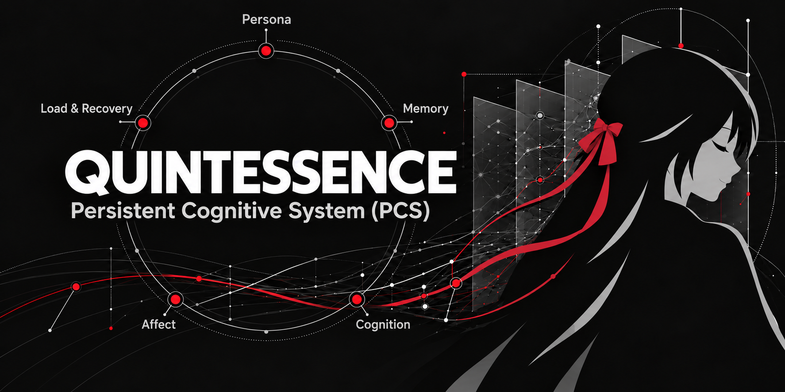

<p align="center">
  
</p>

<h1 align="center">QUINTESSENCE</h1>

<p align="center"><strong>Persistent Cognitive System (PCS)</strong></p>

<p align="center"><em>Preserve · Participate · Change</em></p>

<p align="center">
  
  
  
  
  
</p>

<p align="center">
  <strong>English</strong> · <a href="README.zh-CN.md">简体中文</a>
</p>

<p align="center">
  <a href="ARCHITECTURE.md">Architecture</a> ·
  <a href="ROADMAP.md">Roadmap</a> ·
  <a href="CONTRIBUTING.md">Contributing</a>
</p>

---

QUINTESSENCE is a general-purpose personal AI persistent-state and cognitive collaboration system. It combines a replaceable LLM with long-lived Persona, Memory and Cognition, managed by a trusted host. Persistent state, provenance and belief revision live outside the model; this is research and engineering toward continuity, not a claim of consciousness or complete autonomous learning.

A Persistent Cognitive System keeps experiences, current beliefs, provenance, versions, and unfinished work across calls, and treats model output as a candidate subject to domain rules rather than as directly authoritative state. This differs from a conventional LLM memory layer, which mainly stores and retrieves text for prompts: PCS adds explicit evidence relationships, scoped beliefs, versioned retraction and replacement, formal Context assembly, and commit and audit boundaries. Retrieval is one part; the system also governs whether a proposed belief may become persistent state.

> **Early research stage; status checked 2026-11-05.** Local `main` includes the J-series engineering work and folder-instance A/B/C implementation. Chat, Persona/SDRPE, Scope Recall integration, Cognition governance, recovery and Windows folder selection have code and scoped tests. Windows packaging and installation have been exercised locally; signing, a formal binary release and genuinely clean-machine installation remain unverified or pending. Engineering completion does not establish autonomous cognition or general behavioral reliability.

## Why this matters

A single conversation can look intelligent, but what happens after it ends? Can what happened become evidence for the next understanding? When new evidence overturns an earlier judgment, can the system retain the reason for the revision and later use the appropriate version? Further, can experience gradually form persistent questions, unresolved problems, and stable but evolving individual characteristics?

QUINTESSENCE studies continuity through three stages:

- **Preserve**: experiences and beliefs survive the end of a call, with provenance, time, and version.
- **Participate**: state that is relevant, still valid, and permitted enters the inference context.
- **Change**: new evidence can revise existing beliefs. Whether those revisions later change behavior in new situations must be tested separately.

The long-term goal is a system with identity continuity, memory, cognition, evaluation, and operational rhythm. Current work starts from verifiable belief revision; full autonomous persistent cognition is not yet implemented.

## Where the project stands

| Capability | Current status | Scope |
|---|---|---|
| Persistent state and unified LLM–PCS collaboration | Implemented | Versioned records, formal Context, consult/review, bounded chat/tool orchestration and authoritative receipts |
| Persona and expression | Implemented | Reviewed profile publication/activation, expression policy and examples; optional two-stage SDRPE; model-default style without a custom Persona |
| Scope Recall memory integration | Implemented, with limits | Experience delivery, persisted upstream events, browse/search and bounded automatic recall; semantic consolidation/vector workers are not automatically provisioned by the desktop adapter |
| Cognition | Implemented foundation | Source-linked beliefs, direct/inferred support rules, revision and impact-based automatic/manual review; durable decisions, not proof of semantic truth |
| Conversations and cross-session use | Implemented | Saved transcripts, history search, Memory recall and cognition reuse; model self-reports are not storage receipts |
| Independent instance folders: A/B/C | Implemented and exercised | Empty creation, complete-folder migration/restart, safe partial completion and explicit legacy onboarding |
| Windows desktop and local installer | Tested locally | Folder picker, connection/status, settings and review; unsigned development build, clean-machine test not run |
| Cognitive Workbench V0.2 | Frozen experimental prototype | Separate bespoke demo, not the standard desktop application |
| Dreaming, Work/DSH and deeper growth | Planned / research | See the roadmap; no complete autonomous continual-learning system |

### Current limits

The host adapter currently establishes raw-event storage and lexical recall. Scope Recall semantic consolidation and embedding require separately configured and driven upstream workers; queued work is not evidence that those capabilities ran. PCS deletion does not yet physically remove already-delivered Memory content. Recovery assets travel inside the instance folder, so a joint rollback of database, ledger and Anchor cannot be reliably detected. Windows compatibility with injected overlays remains environment-dependent; local installation is not clean-machine validation.

### A concrete example: revising “this tool does not work”

In a synthetic scenario, a tool fails on a class of paths. The system stores a judgment with evidence and scope. Later evidence appears: the failure was permission-related, and a retest under specified conditions succeeded.

During revision, the model proposes a candidate; PCS checks whether the operation and evidence satisfy the rules. After the old judgment is retracted, the system assembles a new Context and forms a replacement belief with a narrower scope. Version history retains why the change happened. If the second step fails or waits, the system does not pretend that the replacement belief has been established.

**The persistent revision chain is implemented and has actually run.** It is not yet proof that a revised belief will reliably produce better advice in arbitrary new situations.

### How progress is judged

Engineering tests check state updates, versions, validation, and recovery mechanisms. Real-model experiments check whether the model can trigger and correctly use those mechanisms. The two kinds of evidence are reported separately.

The PCS2-010 engineering work is closed. The formal EXP-01 v4 study ran six times: one run completed belief formation, revision, and the later Advice stage; three did not trigger a valid initial operation; two produced invalid operations during revision. Human blind review and final research conclusions remain pending. The earlier five exploratory rounds are a different batch and are not pooled with v4.

The P0 engineering acceptance record includes the offline Python suite, frontend and Rust checks, packaged-sidecar smoke checks, and repository-gate verification; [docs/development/STATUS.md](docs/development/STATUS.md) records the latest run and its exact counts. This shows that the line passes the corresponding engineering checks; it does not prove stable cognitive transfer. In the synthetic C13b run, a real DeepSeek call queried a formally committed belief, and the owner observed the revised belief being used after a client restart; the durable experiment records support the belief/query/commit path, while process-identity and human evaluation remain separately qualified.

## How the system is organized

**PCS holds cognitive state; the model participates in inference; the host performs execution.**

| Part | Responsibility |
|---|---|
| QUINTESSENCE / PCS | Preserve and revise beliefs; manage provenance, versions, and formal context |
| Language model | Answer or propose candidates from the supplied material; model output must pass rule processing before becoming persistent belief |
| Host and application | Provide interaction, authorization, and tool-execution environments; consume PCS through an integration interface |
| Private instance | Store an individual's persona configuration, memories, and persistent state; kept separate from the general source code |

Chitose (千岁) is a private instance in this research. The public project provides general mechanisms and does not include her private experiences or persona assets. Hosts such as DSH are future integration targets; they are not yet integrated and are neither the whole of QUINTESSENCE nor a core runtime dependency.

The five conceptual capabilities in the architecture are Persona, Memory, Cognition, Affect, and Load & Recovery. They describe long-term responsibilities; they do not imply five mature services. See [ARCHITECTURE.md](ARCHITECTURE.md).

## Getting started

The source is public; a signed public binary release is not claimed. For a Windows development package, follow the prerequisites and build commands in [the desktop guide](apps/desktop/README.md#development). Build output stays outside the checkout. A bare Cargo release executable is insufficient: the frozen Python sidecar and its resources must be bundled beside the host.

With the complete application installed:

1. Open QUINTESSENCE → **Settings → Instance folder → Choose folder**.
2. Select an empty folder to initialize, or a complete existing folder to connect. A partial folder is completed only when its component history permits it; damage or unexplained loss stops connection.
3. Configure the supported model endpoint/model and your API credential in Settings. Model service access, authorization and network connectivity are required for external calls; credentials remain in Windows Credential Manager or the deployment process environment.
4. Wait for connection/reload, then chat, browse memory/history and inspect Cognition review. A custom Persona is optional; without one the model uses its own default expression style. The generated Persona README explains how to add one gradually.
5. Quit before copying an instance. Copy the **entire folder**, including safety records, then select its new location. See [instance operations and recovery limits](docs/desktop/INSTANCE-FOLDERS.md).

Unknown legacy component history requires an explicit, audited confirmation that the component never existed. Accepting a new PS06 recovery baseline is a separate decision and does not authorize replacement of lost data.

### Source-tree checks (Windows / Python 3.12+)

```powershell
python tools/run_tests.py
python tools/check_repository.py
```

The core uses the standard library. Folder/Scope Recall and packaged tests additionally need the validated upstream runtime and build prerequisites; see the desktop guide. Tests use synthetic data and loopback providers, with output outside the checkout. Windows is the exercised platform; Linux/macOS support is not established.

## Next step

The J-series and A/B/C engineering increments are implemented within their documented scope. Next work is Dreaming and incremental maintenance, Work/DSH integration, deeper Cognition research, cross-module deletion governance, Persona evolution and installation compatibility. Existing bounded maintenance code is a foundation, not a completed Dreaming system. See [ROADMAP.md](ROADMAP.md).

## Development and contributions

The project is personally led: the maintainer sets architecture, direction and key decisions, using **AI assistance for design, programming, testing and review**. Generated work is checked and verified; neither sole manual authorship nor AI independence is claimed. AI-assisted contributions should disclose their use and follow the project's contribution rules.

Future development of the general PCS uses this repository as the sole authoritative source mainline. The legacy research repository, experiment worktrees, and sealed materials are preserved as historical and research sources only; they are not the code authority for the general PCS.

Contributions are welcome around concrete problems, minimal reproductions, synthetic tests, and well-defined capability gaps. See [CONTRIBUTING.md](CONTRIBUTING.md). Do not submit private conversations, instance databases, persona profiles, keys, or other sensitive data. See [MIGRATION-BOUNDARY.md](docs/development/MIGRATION-BOUNDARY.md) for the maintenance boundary.

## Third-party acknowledgements

Thank you to [Scope Recall](https://github.com/410979729/scope-recall-hermes), repository owner/maintainer **410979729**, and the **scope-recall contributors** for an important foundation of QUINTESSENCE's long-term memory capability. QUINTESSENCE integrates and adapts Scope Recall; its memory engine, storage and retrieval implementation are upstream work. QUINTESSENCE supplies host collaboration, Experience projection/delivery, binding and management integration, and its own Cognition mechanisms.

The validated build baseline is `hermes-scope-recall` **3.14.1**, upstream revision [`2b640260`](https://github.com/410979729/scope-recall-hermes/tree/2b640260134565ac7fef3a76644e352a50866533). Its MIT notice, **Copyright (c) 2026 scope-recall contributors**, and complete [MIT text](licenses/Scope-Recall-MIT.txt) are preserved. See [third-party notices](THIRD_PARTY_NOTICES.md) for dependency licenses and distribution boundaries.

## License and data

General first-party QUINTESSENCE code is licensed under the **Apache License 2.0**; see [LICENSE](LICENSE), [NOTICE](NOTICE), and the [third-party dependency inventory](THIRD_PARTY_NOTICES.md). Any future host-adapter code will be handled according to its source and license; the full DSH upstream repository is not published as first-party code here.

Copyright 2026 Linguist.

Private memories, cognitive traces, persona configuration, personalized training data, and weights are not part of the default open-source scope. The project opens general mechanisms so that each individual's accumulated state remains under its holder's control.
