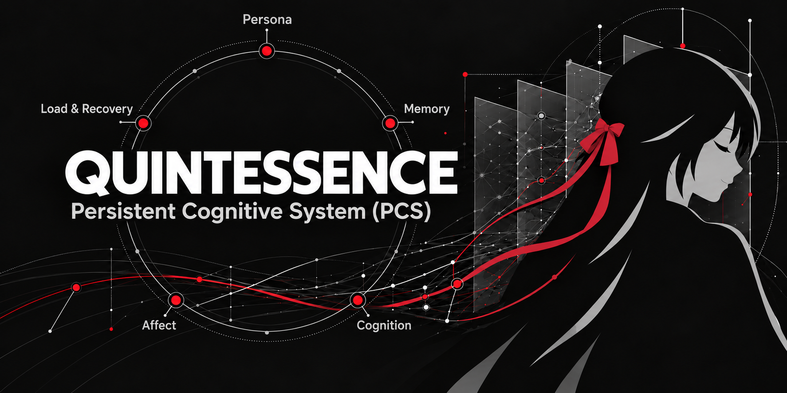

<p align="center">
  
</p>

<h1 align="center">QUINTESSENCE</h1>

<p align="center"><strong>持久认知系统（Persistent Cognitive System, PCS）</strong></p>

<p align="center"><em>让经历留下 · 让认识可以修正 · 让变化能够延续</em></p>

<p align="center">
  
  
  
  
  
</p>

<p align="center">
  <a href="README.md">English</a> · <strong>简体中文</strong>
</p>

<p align="center">
  <a href="ARCHITECTURE.zh-CN.md">系统架构</a> ·
  <a href="ROADMAP.zh-CN.md">演进路线</a> ·
  <a href="CONTRIBUTING.md">贡献指南</a>
</p>

---

QUINTESSENCE 是通用的个人 AI 持续状态与认知协作系统。它将可替换 LLM 的推理能力，与长期保存的 Persona、Memory、Cognition 和可信宿主管理结合。持久状态、证据来源与认识更新位于模型之外；这是面向连续性的研究与工程，不代表已经实现自主意识或完整持续学习。

持久认知系统把经历、当前认识、来源、版本与未完成工作保留在单次调用之外，并把模型输出视为受领域规则约束的候选，而不是直接的权威状态。这与主要存储和检索提示文本的常规 LLM 记忆层不同：PCS 增加了显式证据关系、带范围的认识、版本化撤回与替代、正式 Context 装配，以及提交与审计边界。检索只是其中一部分；系统还要决定一个候选认识能否成为持久状态。

> 早期研究阶段，状态核对至 **2026-11-05**：本地 `main` 已包含 J 系列工程与实例 A/B/C。聊天、Persona/SDRPE、Scope Recall 适配、Cognition 治理、恢复和 Windows 文件夹选择有实现及限定范围内的测试。本机已验证打包与安装；正式二进制发行、签名和真正干净机安装仍未完成。工程完成不等于自主认知或通用行为可靠性已成立。

## 为什么做这件事

一次对话可以表现得很聪明，但对话结束之后，发生过的事情如何成为下一次理解的依据？当新证据推翻旧判断，系统能否保留纠正的来由，并在未来使用适当版本的认识？进一步，经历能否逐渐形成持续关注、尚未解决的问题与稳定而可发展的个体特征？

QUINTESSENCE 从这些问题出发。我们研究的连续性包括三个环节：

- **留下**：经历和认识在调用结束后仍然存在，带有来源、时间与版本。
- **参与**：与当前问题有关、仍然有效且获准使用的状态进入推理上下文。
- **改变**：新证据能够纠正已有认识；这些变化是否进一步影响新情境中的行为，需要单独验证。

长期目标是发展具有身份连续性、记忆、认知、评价与运行节律的系统。当前工作从可验证的认识更新开始，尚未实现完整的持续自主认知。

## 已经走到哪里

| 能力 | 当前状态 | 范围 |
|---|---|---|
| 持续状态与统一 LLM–PCS 协作 | 已实现 | 记录版本、正式 Context、consult/review、有限聊天/工具编排和权威回执 |
| Persona 与表达 | 已实现 | 人格审核发布/激活、表达政策与示例、可选 SDRPE 双阶段；无自定义人格时采用模型默认表达 |
| Scope Recall 长期记忆集成 | 已实现，有边界 | Experience 投递、上游事件持久化、浏览/检索及有界自动召回；桌面适配器不会自动配置并驱动语义/向量 worker |
| Cognition | 已实现基础 | 带来源认识、直接/推断支持规则、修订和按影响分级的自动/人工审核；不保证语义为真 |
| 会话与跨会话能力 | 已实现 | 历史保存/检索、Memory 召回与认识复用；不靠模型自述判断是否保存 |
| 独立实例文件夹 A/B/C | 已实现并演练 | 空目录创建、完整迁移/重启、安全部分补全及显式旧实例登记 |
| Windows 桌面与本机安装 | 已验证 | 文件夹选择、连接状态、设置及审查；未签名开发版，真正干净机未测 |
| Cognitive Workbench V0.2 | 冻结实验原型 | 独立专用编排 Demo，不是标准桌面应用 |
| Dreaming、Work/DSH 与更深入成长 | 规划/研究 | 不代表完整自主持续学习系统 |

### 当前限制

宿主适配器已建立原文事件保存与词法召回；Scope Recall 的语义提炼、向量加工还需要另行配置并驱动上游 worker，排队不等于已经运行。PCS 删除尚不自动物理删除已投递的 Memory 正文。恢复资产随实例保存，数据库、账本与 Anchor 整体共同回滚无法可靠检测。本机外部叠加层可能影响 WebView 兼容性；本机安装不能代替干净机验证。

### 一个具体例子：修正“这个工具不能用”的认识

在合成场景中，一个工具处理某类路径时失败。系统保存的是带证据和范围的判断。后来出现新证据：失败与权限有关，指定条件下的复测已经成功。

纠正过程中，模型提出候选，PCS 检查操作和证据是否符合规则；旧判断被撤回后，系统装配新的 Context，再形成范围更准确的替代认识。版本历史保留这次变化的来由。第二步若失败或选择等待，系统不会假装替代认识已经建立。

**当前成果是这条持久纠正链已经落地并实际运行过。** 它还不足以证明，修正后的认识能在任意新情境中稳定产生更好的建议。

### 我们怎样判断进展

工程测试检查状态更新、版本、校验和恢复等机制；真实模型实验检查模型是否能触发并正确使用这些机制。两种证据分别报告。

010 的工程工作已关闭。正式 EXP-01 v4 共六次运行，其中一次完整走过认识形成、纠正与后续 Advice 阶段，三次未触发有效初始操作，两次在纠正阶段产生无效操作；人工盲评与最终研究结论仍待完成。此前五轮探索属于另一批次，不与 v4 合并统计。

P0 的工程验收记录包括离线 Python 测试套件、前端与 Rust 检查、打包 sidecar smoke 和仓库 Gate 检查；最近一次运行及其分项计数见 [docs/development/STATUS.md](docs/development/STATUS.md)。这说明该主线通过对应工程检查，并不等于已经证明稳定的认知迁移效果。合成 C13b 实验中，真实 DeepSeek 调用查询了正式提交的 Belief，负责人观察到客户端重启后修订认识被使用；持久实验记录支持 Belief/查询/提交路径，但进程边界与人工评价仍需分别限定。

## 系统怎样组织

**PCS 持有认知状态，模型参与推理，宿主负责实际执行。**

| 部分 | 职责 |
|---|---|
| QUINTESSENCE / PCS | 保存与修正认识，管理来源、版本及正式上下文 |
| 语言模型 | 根据提供的材料回答或提出候选；模型输出需经规则处理才能成为持久认识 |
| 宿主与应用 | 提供交互、授权和工具执行环境；通过集成接口使用 PCS |
| 私有实例 | 保存具体个体的人格配置、记忆与持续状态；与通用源码分离 |

千岁（Chitose）是该研究中的一个私有实例。公开项目提供通用机制，不附带她的私人经历或人格资产。DSH 等宿主是未来的集成对象，尚未集成，也不是 QUINTESSENCE 的全部实现或核心运行依赖。

架构中的五项概念能力为 Persona、Memory、Cognition、Affect、Load & Recovery。它们描述长期职责，并不代表已有五个成熟服务。详见 [ARCHITECTURE.zh-CN.md](ARCHITECTURE.zh-CN.md)。

## 获取与运行

源码已公开，尚不宣称已有签名的公开二进制发行版。Windows 开发构建的环境与命令见[桌面开发说明](apps/desktop/README.md#development)，产物应放在源码树外。裸 Cargo release 程序不足以运行，必须同时分发冻结 Python sidecar 与资源。

使用完整安装产物时：

1. 打开 QUINTESSENCE →「设置」→「实例文件夹」→「选择文件夹」。
2. 空目录自动初始化；完整实例自动连接。部分实例只补有依据的未创建组件，损坏或无解释丢失会停止连接。
3. 在模型设置配置支持的服务地址、模型与 API 凭据。外部模型调用需要模型服务、授权和网络，不能理解为完全零配置。凭据留在 Windows 凭据管理器或部署进程环境中。
4. 连接并重新加载后聊天、查看记忆/历史和认知审查。没有自定义 Persona 也可采用模型默认表达；生成的中文 README 指导逐步完善人格。
5. 迁移前退出所有写入者，复制整个实例文件夹及安全记录，再选择新位置。详见[实例操作与恢复边界](docs/desktop/INSTANCE-FOLDERS.md)。

未知旧组件历史需显式核对“此前从未建立”并留审计；PS06 基线接入是另一项独立确认，不能授权以空数据替代丢失内容。

### 源码树检查（Windows / Python 3.12+）

```powershell
python tools/run_tests.py
python tools/check_repository.py
```

核心使用标准库。文件夹/Scope Recall 与冻结后端测试还需要经过验证的上游运行依赖及构建环境，见桌面说明。测试使用合成数据和回环假服务，输出位于源码树外。已演练平台为 Windows；Linux/macOS 支持尚未成立。

## 下一步

J 系列与 A/B/C 已在其交付范围内完成工程。后续重点是 Dreaming 增量维护、Work/DSH 集成、深入 Cognition 研究、跨模块删除治理、Persona 演化与安装兼容性。已有有限维护代码是基础，不是完整 Dreaming。详见 [ROADMAP.zh-CN.md](ROADMAP.zh-CN.md)。

## 开发与贡献

项目由个人主导架构、方向和关键决策，使用 **AI 辅助设计、编程、测试与审查**，并对产物进行检查与验证；不宣称代码全部由个人手写，也不把 AI 描述为独立承担项目决策。AI 辅助贡献应如实披露并遵循贡献规则。

通用 PCS 的后续开发以本仓库为唯一权威源码主线；旧研究仓库、实验 worktree 与封存材料仅保留为历史与研究来源，不作为通用 PCS 的代码权威。

欢迎围绕具体问题、最小复现、合成测试和明确的能力缺口参与改进。贡献规范见 [CONTRIBUTING.md](CONTRIBUTING.md)。请勿提交私人对话、实例数据库、人格档案、密钥或其他敏感数据。维护边界见 [MIGRATION-BOUNDARY.md](docs/development/MIGRATION-BOUNDARY.md)。

## 第三方致谢

感谢 [Scope Recall](https://github.com/410979729/scope-recall-hermes)、仓库所有者/维护者 **410979729** 及 **scope-recall contributors**，为 QUINTESSENCE 的长期记忆能力提供重要基础。QUINTESSENCE 集成和适配 Scope Recall；记忆引擎及内部存储、检索实现属于上游贡献。QUINTESSENCE 提供宿主协作、Experience 投递、绑定与管理适配，以及自研 Cognition。

经过验证的构建基线为 `hermes-scope-recall` **3.14.1**、上游提交 [`2b640260`](https://github.com/410979729/scope-recall-hermes/tree/2b640260134565ac7fef3a76644e352a50866533)。保留 MIT 声明 **Copyright (c) 2026 scope-recall contributors** 和[完整许可文本](licenses/Scope-Recall-MIT.txt)。其他依赖与分发边界见[第三方声明](THIRD_PARTY_NOTICES.md)。

## 许可与数据

QUINTESSENCE 通用自研代码采用 **Apache License 2.0**，参见 [LICENSE](LICENSE)、[NOTICE](NOTICE) 与[第三方依赖清单](THIRD_PARTY_NOTICES.md)。如未来纳入宿主适配代码，将按来源与许可范围处理；不将完整 DSH 上游仓库作为本项目自研代码发布。

Copyright 2026 Linguist.

私人记忆、认知轨迹、人格配置、个性化训练数据和权重不属于默认开源范围。开放通用机制，让具体个体的积累由其持有者控制。
